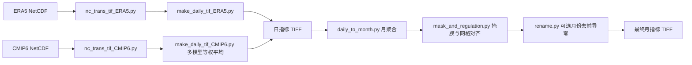

# ERA5 / CMIP6 气候数据处理

将 ERA5 历史数据和 CMIP6 多模型数据转换为日尺度气候指标，再生成按情景、变量分类的月尺度 GeoTIFF。修改配置实例后，运行 `Runner.py` 即可完成选定流程。

## 处理流程



两个配置类只负责描述设置；计算逻辑由各阶段模块负责。这样可以同时配置 ERA5 和 CMIP6，也可以单独运行任意一种数据。

## 安装

需要 Python 3.9 或更高版本、NumPy、netCDF4 和 GDAL。推荐通过 conda-forge 安装，避免 Windows 上 GDAL 与系统库版本不匹配：

```bash
conda env create -f environment.yml
conda activate climate-processing
```

如果已有匹配的 GDAL 环境，也可以使用：

```bash
python -m pip install -r requirements.txt
```

ArcPy 不是 pip 依赖。只有选择 `mask_backend="arcpy"` 时，才需要在安装了 ArcGIS Pro 且具有 Spatial Analyst 许可的 Python 环境中运行；其它步骤仍需要 GDAL 和 netCDF4。默认 GDAL 后端不需要 ArcGIS。

## 快速开始

1. 将 `LocalConfig.example.py` 复制为 `LocalConfig.py`，修改根目录、输入目录、情景、模型和需要输出的变量。`LocalConfig.py` 已被 `.gitignore` 排除。
2. 按下面的目录结构准备 NetCDF 和掩膜。
3. 在 IDE 中选择上述 Python 环境，打开并点击运行 `Runner.py`；或在本文件夹执行 `python Runner.py`。

`Runner.py` 优先读取同目录的 `LocalConfig.py`；不存在时读取 `Samples.py` 的 `CONFIGS` 列表。两种方式都可以直接修改实例后运行。示例默认路径用于展示布局，不附带正式气候数据，必须先准备输入。

```python
from pathlib import Path
from Config import ERA5, CMIP6

ROOT_PATH = Path("D:/climate_workspace")
CONFIGS = [
    ERA5(root_path=ROOT_PATH, time_field="valid_time"),
    CMIP6(root_path=ROOT_PATH, scenarios=("ssp245",),
          models=("CanESM5", "MIROC6"), variables=("rad",), min_models=2),
]
```

只有 ERA5 时，列表只放 ERA5 实例；只有 CMIP6 时同理。也可以给实例设置 `enabled=False` 暂停运行。

```bash
python Runner.py --dry-run
python Runner.py --only ERA5
python Runner.py --only CMIP6 --stages daily monthly mask rename
python Runner.py --config LocalConfig.py
```

`--dry-run` 仅验证配置并打印目录，不读写数据。`--stages` 可从已有中间结果继续，但所需输入必须已经存在。步骤始终按 `nc → daily → monthly → mask → rename` 排序。仅有日数据时用 `monthly mask rename`；仅有月数据时用 `mask rename`。

失败会返回非零退出码，并显示出错路径或配置；已完成的结果会保留。默认 `overwrite=False`，遇到已有输出会报错。如果确实需要重跑并替换生成结果，在实例中设置 `overwrite=True`。

## 配置与流程图的对应关系

| 流程图中的配置 | 本版本配置 | 含义 |
| --- | --- | --- |
| Root path | `root_path` | 默认输入和各阶段输出的共同根目录 |
| ERA5 nc_folder | `nc_folder` | ERA5 NetCDF 所在目录 |
| ERA5 var_dict | `var_dict` | `{文件名: NetCDF 内部变量名}` |
| CMIP6 nc_folder | `nc_folder` | 下一级为情景和原始变量目录 |
| L_ssp | `scenarios` | CMIP6 情景列表；ERA5 使用 `scenario="history"` |
| L_model | `models` | CMIP6 模型列表 |
| time field | `time_field` | NetCDF 时间坐标变量；ERA5 默认 `valid_time`，CMIP6 默认 `time` |
| variety list | `variables` | 需要生成的指标：hurs、pre、wdf、rad、wnd、tmx、tmn |
| results unit dict | `results_unit_dict` + `scales` | 输出物理单位说明与保存数值的缩放倍数 |

`time_field` 对应在 ArcGIS 查看 NetCDF 时显示的时间变量；TIFF 的日/月信息写入文件名与元数据，不依赖 ArcGIS 时间字段。

`results_unit_dict` 描述公式产生的单位并写入元数据；修改字符串不会自动转换物理量。`scales` 控制整数保存，例如 `tmx` 的 2512 表示 25.12 ℃。降水输入单位通过 `precipitation_unit` 明确配置，支持 `kg m-2 s-1`、`mm/s`、`m/s`、`mm/day`、`m/day`。

各阶段目录可以分别指定 `tif_root`、`daily_root`、`monthly_root`、`result_root`，覆盖根目录推导的默认路径。相对路径以这个重构文件夹为基准，不受启动时工作目录影响。根目录和阶段目录应在创建实例时指定。

其它常用设置：

| 配置 | 默认值 | 用途 |
| --- | --- | --- |
| `stages` | 所有五个步骤 | 跳过已经完成的步骤 |
| `monthly_methods` | 见下表 | 各指标选择 `sum` 或 `mean` |
| `wet_day_threshold_mm` | 1.0 | 日降水 ≥ 此阈值记为湿日 |
| `nodata` | -9999 | 结果 TIFF 的缺失值 |
| `mask_path` | root_path/mask.tif | 栅格掩膜，也用于定义最终网格 |
| `mask_backend` | gdal | 也可选 arcpy |
| `resampling` | bilinear | GDAL 支持 near、bilinear、cubic、average；ArcPy 不支持 average |
| `mask_zero_is_nodata` | False | False 时掩膜的 0 值仍有效；True 适用于 0/1 二值掩膜 |
| `normalize_longitude` | True | 将经度转换为 [-180, 180) 并重排列 |
| `remove_month_leading_zero` | True | 最终文件名 2001-01.tif → 2001-1.tif |
| `min_models` | 1 | CMIP6 每个日期至少需要多少个模型文件 |
| `model_grid_policy` | strict | strict 检查网格一致；align 重采样后再平均 |
| `source_variables` | 标准 CMIP6 变量映射 | 例如 wnd 默认对应 sfcWind，若原数据使用 sfcwind 可修改 |
| `model_name_index` | 2 | CMIP6 文件名按下划线分段，模型名称所在索引 |

## 输入和输出目录

默认共享根目录结构如下。`raw_tif` 是原始变量的中间结果；`daily` 是计算后的日指标；`monthly` 是月聚合结果；`result` 是掩膜和对齐后的最终结果。

```text
workspace/
├── mask.tif
├── netcdf/
│   ├── ERA5/
│   │   ├── 2m_temperature_0_daily-mean.nc
│   │   └── ...                    # Config.ERA5_FILES 中的其余文件
│   └── CMIP6/
│       └── ssp245/
│           └── rsds/
│               ├── rsds_day_CanESM5_...nc
│               └── rsds_day_MIROC6_...nc
├── raw_tif/
│   ├── ERA5/history/t2m/2001-01-01.tif
│   └── CMIP6/ssp245/rsds_CanESM5/2001-01-01.tif
├── daily/
│   ├── history/tmx/2001-01-01.tif
│   └── ssp245/rad/2001-01-01.tif
├── monthly/ssp245/rad/2001-01.tif
└── result/ssp245/rad/2001-1.tif
```

ERA5 的 `var_dict` 完整默认映射见 `Config.py`。只输出 `rad` 时只需辐射文件；输出 `hurs` 时需要露点温度和空气温度；输出 `wnd` 时需要 u10、v10。其它 ERA5 输入温度应为 K，辐射为 J/m²。

CMIP6 输入按 `情景/原始变量/*.nc` 分类；模型从标准文件名 `变量_day_模型_...nc` 提取。默认映射为 `hurs→hurs`、`pre/wdf→pr`、`rad→rsds`、`wnd→sfcWind`、`tmx→tasmax`、`tmn→tasmin`。

所有输入应当已经是**日尺度**：一个日期只有一个时间步。小时数据不会在此流程中自动转为日数据。只支持一维规则经纬度网格，并允许任意时间/经纬度维度排列和长度为 1 的额外维度。曲线网格、多个成员或层次需要预先选取或重网格化。

## 指标、整数编码和月聚合

| 指标 | 日物理量 | 保存倍数 | 默认月聚合 |
| --- | --- | --- | --- |
| hurs | 相对湿度 % | 100 | 日均值 |
| pre | 降水 mm/day | 10 | 日值求和，mm/month |
| wdf | 湿日标志 0 / 1 | 100 | 日值求和，湿日数 ×100 |
| rad | 日平均辐射通量 W/m² | 100 | 日值求和，保留原脚本规则 |
| wnd | 风速 m/s | 100 | 日均值 |
| tmx | 日最高温度 ℃ | 100 | 日均值 |
| tmn | 日最低温度 ℃ | 100 | 日均值 |

原始变量 TIFF 保存 Float32；日/月指标及 GDAL 掩膜结果使用 Int32，乘以倍数后四舍五入，避免原脚本 Int16 溢出。有效数据与 NoData 编码冲突或超过 Int32 范围时会报错。

ERA5 湿度沿用原来的饱和水汽压公式；风速由 `sqrt(u10² + v10²)` 得到。ERA5 与 CMIP6 的降水率默认按 `kg m-2 s-1` 乘 86400 转为 mm/day。若输入是 m/s，应设置 `precipitation_unit="m/s"`，不能直接复用 86400。

CMIP6 对每个像元的可用模型值做等权平均，NoData 不参与；全部缺失则输出 NoData。`min_models` 检查每个日期的可用文件数，不是逐像元的有效模型数。默认允许缺失模型并打印提示；要求完整模型集合时将其设置为模型总数。`wdf` 按原代码语义，先平均各模型降水，再判断湿日。

`model_grid_policy="align"` 将所有模型重采样到该情景、该变量中第一个可用配置模型的首日网格；参考网格在各日期之间保持固定。默认 strict 在网格不一致时直接报错。不同 CF 历法的模型会报错，需要先统一历法再进行多模型平均。

**辐射求和不等于月辐射能量。** 默认沿用原脚本 `rad=sum`；如果需要月平均辐射通量，设置 `monthly_methods["rad"]="mean"`。转换到 MJ/m² 等能量单位还需要时间积分，当前流程没有执行该转换。

月聚合只使用已有日期，不自动补齐或拒绝不完整月份；实际参与天数记录在 `DAYS_PRESENT` 元数据中。因此正式分析前需要检查日期完整性。CF 历法会保留，例如 `360_day` 的 2 月 30 日可正常分组，程序不将其强制转换成公历日期。

GDAL 后端把结果重采样到掩膜的投影、范围、行列数和像元位置，再排除掩膜 NoData；默认掩膜中的有效 0 值保留。ArcPy 后端沿用 `ExtractByMask` 与环境设置，输出类型和元数据遵循 ArcGIS，自身许可会在结束或异常时释放。两种后端的插值结果可能有差异；需要复现原 ArcGIS 结果时选 arcpy。

## 参考实例

`Samples.py` 提供：

- `ERA5_EXAMPLE`、`CMIP6_EXAMPLE`：默认可移植配置。
- `ERA5_PERSONAL`：原历史数据的网络路径、变量映射、时间字段和 ArcPy 掩膜设置。
- `CMIP6_PERSONAL`：原未来数据网络路径、ssp245、七个模型及辐射变量设置。
- `CMIP6_RAD_2023`：原脚本当前 `E:/rad_2023` 的日指标、月指标、结果目录，从已有原始日 TIFF 开始处理。


